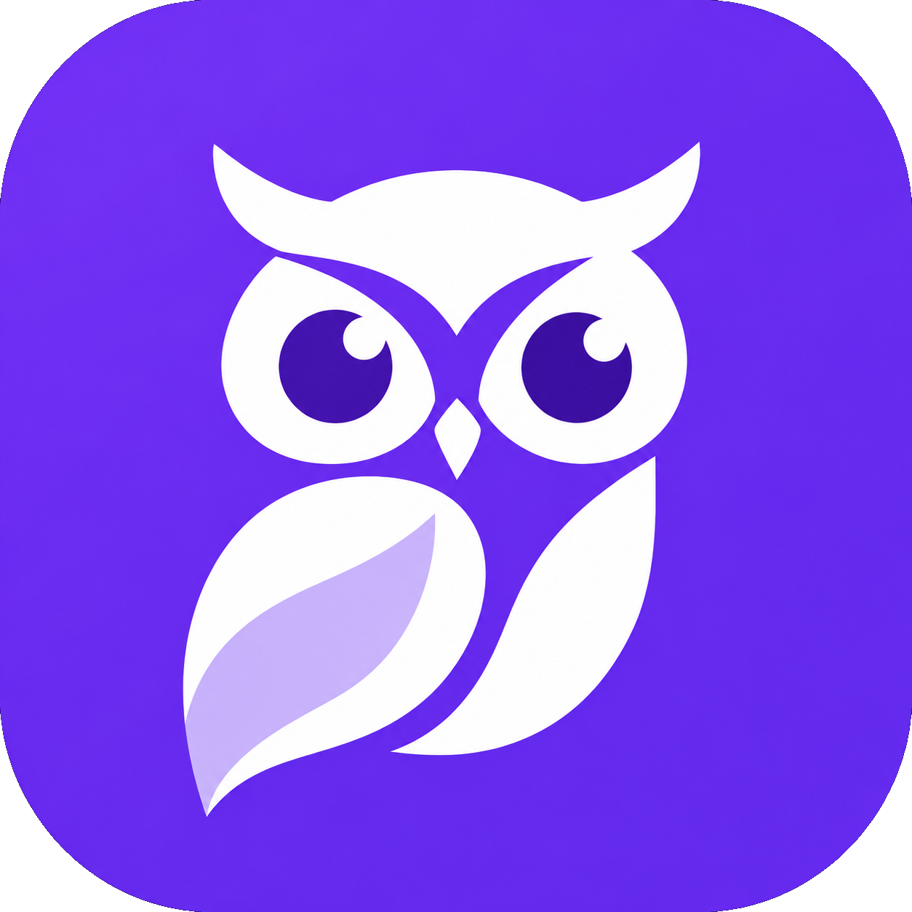
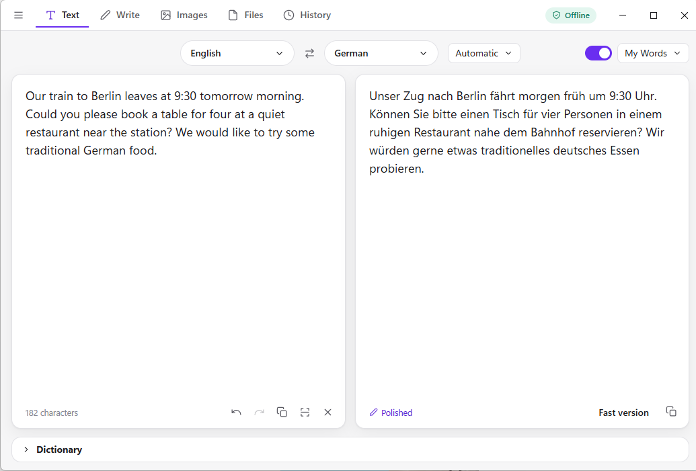
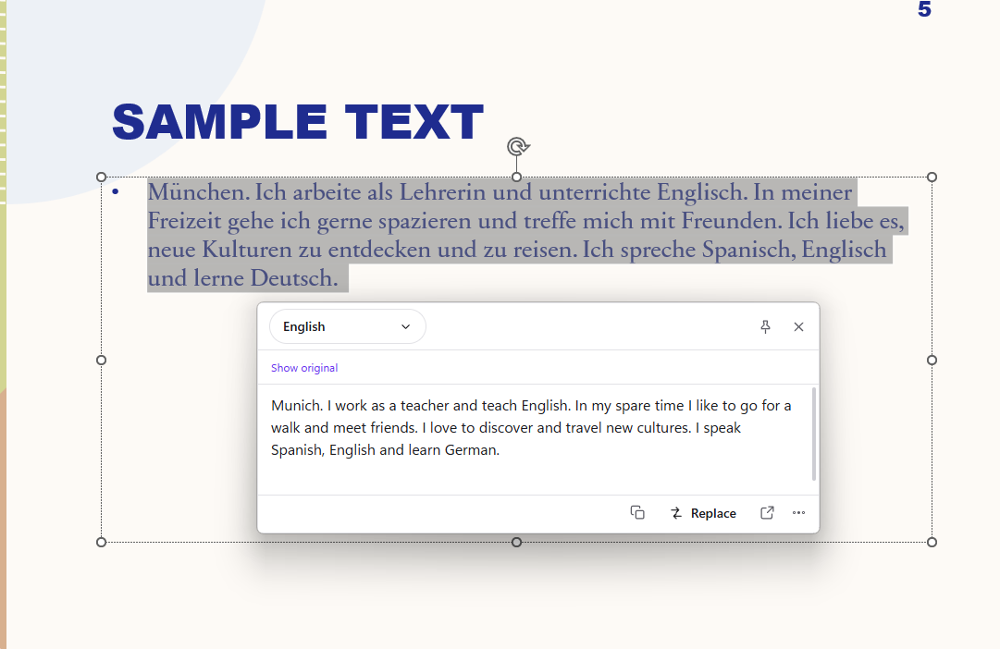
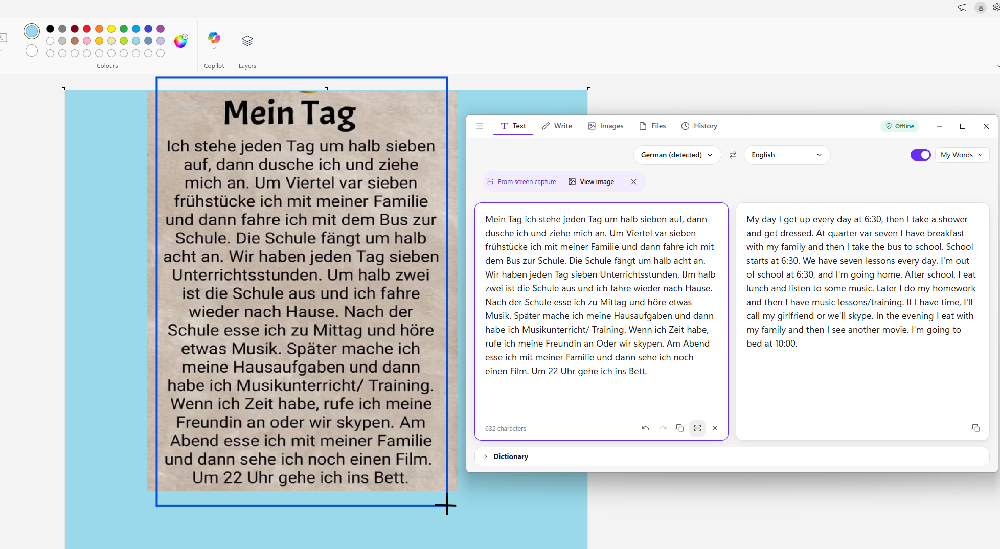
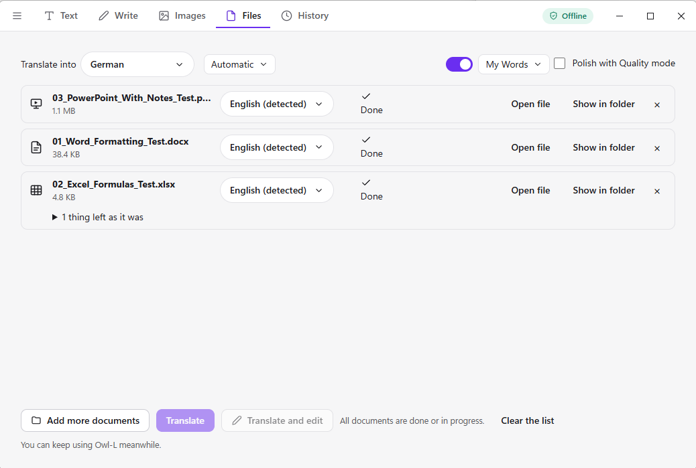
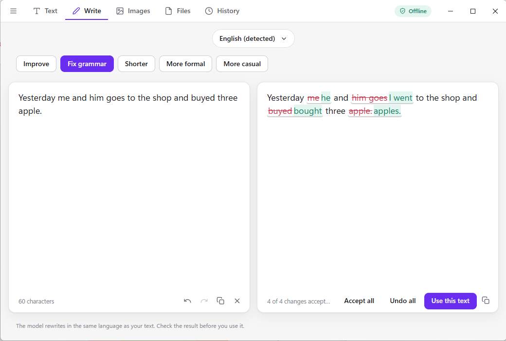
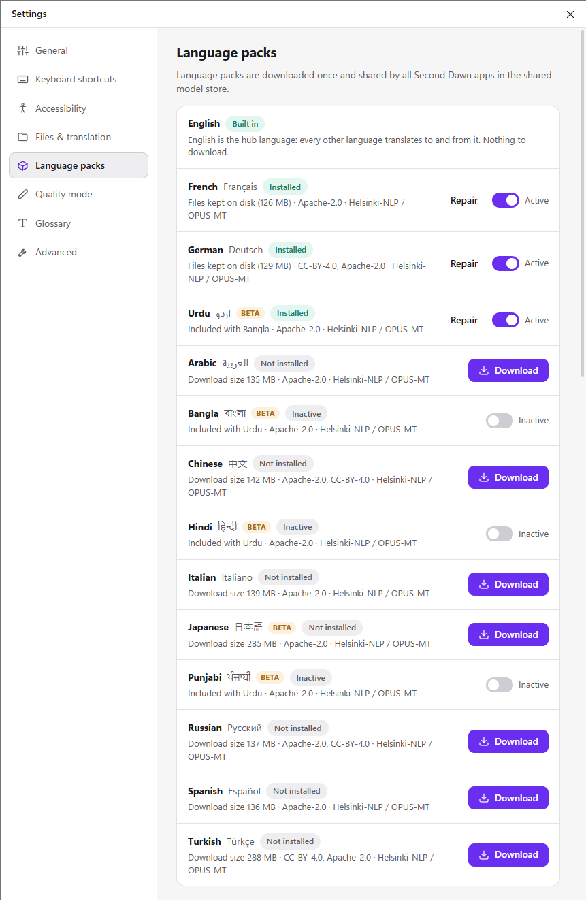
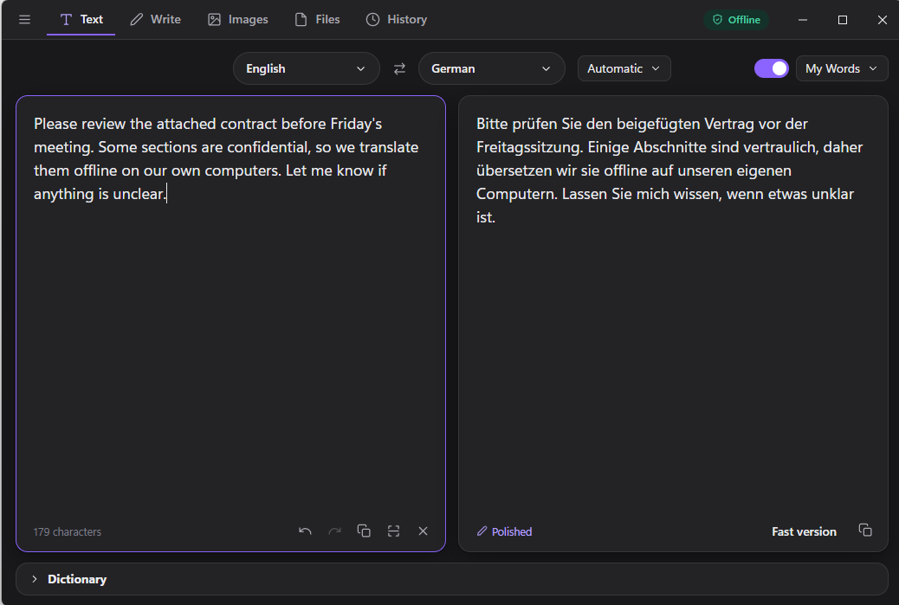

<p align="center">
  
</p>

<h1 align="center">Owl-L</h1>
<p align="center"><b>A free, open-source, offline translator for Windows.<br />Your text never leaves your computer.</b></p>

<p align="center">
  <a href="https://github.com/Second-Dawn-Lab/owll/releases/latest"></a>
  <a href="https://github.com/Second-Dawn-Lab/owll/releases"></a>
  <a href="LICENSE"></a>
  
</p>

<h3 align="center"><a href="https://github.com/Second-Dawn-Lab/owll/releases/latest">⬇ Download Owl-L for Windows</a></h3>

<p align="center">
  
</p>

## Why Owl-L

- **Offline and private.** Translation runs on your computer. There is no telemetry, and your text, files and screenshots are never sent anywhere.
- **Free and open source.** MIT licensed, no paywall, no "pro" tier.
- **No account.** Install it and translate.
- **Fast on a normal laptop.** No graphics card needed. The base translation engine is small (about 125 to 290 MB per language).
- **Works in any app.** Select text anywhere and press Ctrl+C twice, or draw a box around anything on the screen.

## Features

### Text translation, with an optional Quality mode

Two panes, automatic language detection, word alternatives (click a word of the translation to choose another one), a history and a swap button. **Quality mode** is optional and off by default: a small language model that also runs on your computer polishes the translation, sets formal or informal tone and can offer other ways to phrase a sentence. Sentences it polished are marked, and the **Fast version** is one click away.

### Ctrl+C+C in any app

Select text in any program and press **Ctrl+C twice**: the translation appears in a small popup next to the pointer. Copy it, pin it, open it in the main window, or **Replace** the selected text with the translation.

<p align="center">
  
</p>

### Translate text on the screen: Ctrl+Shift+O

Draw a box around text in an image, a video, a locked PDF or a program that does not let you copy. Owl-L reads it with Windows' built-in text recognition and translates it. The result opens with the image, the recognized text (which you can correct) and the translation.

<p align="center">
  
</p>

### Live captions for videos and meetings: Ctrl+Shift+L

Draw a box around subtitles or around the caption area of a **Teams, Zoom or Google Meet** call. A floating caption bar below it keeps translating what appears there, line by line, and for meetings follows each speaker with their **name** (the name is shown, not translated). Owl-L reads the captions that are on the screen; it does not listen to audio, so the meeting app's own live captions have to be turned on. Stop with the shortcut, the bar's close button or Esc. (The caption bar is hidden from screen capture on purpose, so there is no screenshot of it.)

### Documents

Translate **Word, PowerPoint, Excel and text files, and PDFs** (a PDF becomes a Word document) with the formatting kept. Add several files at once, or choose **Translate and edit** to review and change the translation sentence by sentence before saving. Quality mode can polish documents too.

<p align="center">
  
</p>

### Write tab

Fix grammar, **Improve**, make a text **Shorter**, **More formal** or **More casual**, in the same language as your text. With Quality mode on, every change is shown word by word and you accept or undo each one.

<p align="center">
  
</p>

### Glossary and offline dictionary

Add the terms that must be translated your way (names, product words) and import or export them as CSV. With Quality mode on, glossary terms are also inflected correctly ("owl" → "Eulen"). An **offline dictionary** (Wiktionary data) looks up words with no internet.

### Language packs

Install only the languages you need, once. Each pack is checked against a checksum and can be repaired or removed in one click.

<p align="center">
  
</p>

### Light and dark mode

The interface follows your system theme and is available in English and German.

<p align="center">
  
</p>

## Languages

English is built in; every other language translates to and from English (two non-English languages go through English). **Beta** languages work but are noticeably less polished.

| Language | | Language | |
|---|---|---|---|
| Arabic (العربية) | | Italian (Italiano) | |
| Bengali (বাংলা) | Beta | Japanese (日本語) | Beta |
| Chinese (中文) | | Punjabi (ਪੰਜਾਬੀ) | Beta |
| French (Français) | | Russian (Русский) | |
| German (Deutsch) | | Spanish (Español) | |
| Hindi (हिन्दी) | Beta | Turkish (Türkçe) | |
| Urdu (اردو) | Beta | | |

Bengali, Hindi, Punjabi and Urdu share one language pack. Quality mode works with the same languages, but a small local model is less reliable in some of them, so check important text.

## Getting started

1. **Download** `Owl-L_x.y.z_x64-setup.exe` from [GitHub Releases](https://github.com/Second-Dawn-Lab/owll/releases/latest) and run it.
2. **SmartScreen:** until the installer is code-signed (we have applied for free signing from SignPath Foundation, see [Code signing policy](#code-signing-policy)), Windows may show "Windows protected your PC". Click **More info**, then **Run anyway**. The installer is built on GitHub from the source code in this repository.
3. **First start:** choose your languages; Owl-L downloads each language pack once (about 125 to 290 MB each). After that it works offline.
4. **Use it:**

| Shortcut | What it does |
|---|---|
| **Ctrl+C+C** (press Ctrl+C twice) | Translate the selected text in any app |
| **Ctrl+Shift+O** | Draw a box around text on the screen and translate it |
| **Ctrl+Shift+L** | Live captions for a region (subtitles, meeting captions) |

All shortcuts can be changed or switched off in **Settings, Keyboard shortcuts**.

**Quality mode (optional):** Settings, Quality mode, switch it on and press Download. It fetches the small `llama-server` program (25 MB) and a language model (1.1 GB by default; a 2.5 GB model for rewriting and European languages is optional). The model needs about 2 GB of memory while it works and is freed after a few idle minutes. If you already run [Ollama](https://ollama.com) on this computer, Owl-L can use it instead.

## Privacy and offline use

Once a language pack is installed, translation runs fully on your device. This program will not transfer any information to other networked systems unless specifically requested by the user or the person installing or operating it.

**No telemetry, no accounts, no analytics, no crash reports.** Owl-L never sends your text, screenshots, files or history anywhere. What does leave your machine, and when:

| What | When | Where to |
|---|---|---|
| Language pack and dictionary downloads | Only when you install a pack | A plain download from [Hugging Face](https://huggingface.co/Second-Dawn-Lab/owll-language-packs), checked against a checksum. Hugging Face sees the usual connection data (your IP address and the file you ask for). |
| Quality mode downloads (optional, off by default) | Only when you turn Quality mode on and press Download | A plain download of the `llama-server` program and one language model from [Hugging Face](https://huggingface.co/Second-Dawn-Lab/owll-quality-packs) (exact copies of the authors' files; if that fails, the authors' own repositories, e.g. the llama.cpp release on GitHub), each checked against a checksum. |
| Update check | At most once a day at startup, and when you click "Check for updates" | A small file (`latest.json`) from this repository's latest [GitHub release](https://github.com/Second-Dawn-Lab/owll/releases). The new installer is downloaded only if you click "Update and restart". |
| Quality mode, while you use it | Only with Quality mode on | **Only this computer**: a `llama-server` that Owl-L starts on a local port, or an Ollama you already run. Owl-L refuses any address that is not `127.0.0.1`, `localhost` or `[::1]`. |

Everything else (translation, text recognition, history, settings) stays on your computer. History can be turned off or cleared in the app.

## Code signing policy

Free code signing provided by [SignPath.io](https://signpath.io), certificate by [SignPath Foundation](https://signpath.org). Only installers and programs built by this repository's Release workflow on GitHub Actions are signed, and every signing request is approved manually. See the full [code signing policy](docs/CODE_SIGNING_POLICY.md). (Signing starts when the application is approved; until then the installer is unsigned.)

## Uninstall

Windows **Settings, Apps, Installed apps**, find **Owl-L**, **Uninstall**. The uninstaller asks whether to also delete Owl-L's own settings and translation history (`%AppData%\SecondDawn\owll`). It always keeps the downloaded language and model packs in `%AppData%\SecondDawn\models`, because other Second Dawn apps may use them; delete that folder yourself to free the space. Owl-L stores nothing else on your computer and has no account to close.

## FAQ

**Is it really offline?** Yes, for translating. The only times Owl-L uses the internet are the downloads you ask for and a once-a-day update check, listed in the [privacy table](#privacy-and-offline-use). You can disconnect the computer after the downloads and keep translating.

**How big are the downloads?** The installer is small. Each language pack is about 125 to 290 MB. Quality mode is optional: 25 MB for the runtime plus 1.1 GB for the default model (2.5 GB for the optional larger one). Dictionaries are about 1 to 15 MB each.

**Which computers does it run on?** 64-bit Windows 10 and 11. No graphics card is needed. Quality mode was tested on a 6-core desktop CPU from 2019 with 16 GB of memory; a polished sentence takes about one to two seconds there.

**Is Quality mode as good as an online translator?** We make no such claim. It improves the fast translation (more natural wording, tone, glossary forms) but a small local model can still make mistakes, so check what matters. The fast translation is always available next to it.

**Why not macOS or Linux?** Planned. Owl-L is built with Tauri, so a port is possible, but the screen capture and the shortcuts are Windows-only for now. Tell us if you need it: [open an issue](https://github.com/Second-Dawn-Lab/owll/issues).

**Why is the installer flagged by Windows?** See [Getting started](#getting-started): the installer is not signed yet.

## Credits and licenses

Owl-L is MIT licensed ([LICENSE](LICENSE)) and stands on the work of others; full attributions are in the app's About screen.

- **Translation models:** [OPUS-MT](https://github.com/Helsinki-NLP/Opus-MT) by Helsinki-NLP (Apache-2.0 and CC-BY-4.0), run with [CTranslate2](https://github.com/OpenNMT/CTranslate2) (MIT)
- **Quality mode models:** [Tencent Hy-MT2](https://huggingface.co/tencent) (Apache-2.0), [Index-Translate](https://huggingface.co/IndexTeam) by bilibili's IndexTeam (Apache-2.0), [Phi-4 mini](https://huggingface.co/microsoft/Phi-4-mini-instruct) by Microsoft (MIT), run with [llama.cpp](https://github.com/ggml-org/llama.cpp) (MIT)
- **Dictionary:** [Wiktionary](https://www.wiktionary.org) contributors (CC BY-SA 4.0), extracted by wiktextract and published by [kaikki.org](https://kaikki.org)
- **App framework:** [Tauri](https://tauri.app)

Owl-L is an independent project and is not affiliated with any translation service.

## Contributing

Bug reports, ideas and pull requests are welcome. See [CONTRIBUTING](https://github.com/Second-Dawn-Lab/.github/blob/main/CONTRIBUTING.md) and the [Code of Conduct](CODE_OF_CONDUCT.md). To report a vulnerability, follow [SECURITY.md](SECURITY.md).

<details>
<summary><b>Build from source</b></summary>

### Prerequisites

- Node.js 20+, [pnpm](https://pnpm.io), Rust (stable) and the [Tauri prerequisites](https://tauri.app/start/prerequisites/)
- **Windows:** the translation engine ([CTranslate2](https://github.com/OpenNMT/CTranslate2) with oneDNN) is compiled from source on the first build (about 13 minutes, a few GB of RAM). You need Visual Studio Build Tools (Desktop development with C++) and [CMake](https://cmake.org/download/) 3.18+ on your `PATH`. The static C runtime is set in [`.cargo/config.toml`](.cargo/config.toml).

### Get the code

Owl-L uses the shared code in [`dawn-core`](https://github.com/Second-Dawn-Lab/dawn-core), which must sit **next to** this folder:

```text
SecondDawn/
  dawn-core/
  owll/        <- this repo
```

```bash
git clone https://github.com/Second-Dawn-Lab/dawn-core
git clone https://github.com/Second-Dawn-Lab/owll
cd dawn-core && pnpm install      # the shared packages need their own dependencies
cd ../owll && pnpm install
```

Rust crates are path dependencies (`../dawn-core/crates/...`) and the TypeScript packages are `link:` dependencies (`../dawn-core/packages/...`), so edits in `dawn-core` show up here immediately, including hot reload in `tauri dev`.

### Run and build

```bash
pnpm tauri dev      # or run-owll.bat on Windows
pnpm build          # frontend only (the Tauri crate needs ./dist to exist)
pnpm tauri build    # installer
pnpm dev            # UI alone in a browser with a mock backend (src/ipc.mock.ts); add ?window=settings
```

The app starts with only English. Open **Language packs** (menu → Language packs) and download a language. Until the packs are hosted, build them locally: see `dawn-core/docs/models.md` and `dawn-core/tools/convert-models`.

### Checks and tests

```bash
pnpm lint
pnpm typecheck
cargo check --workspace
cargo test --workspace                                                      # unit tests
cargo test -p dawn-translate --test integration -- --ignored --nocapture    # needs converted de + ur models
```

### Updating dawn-core

CI and releases check out the `dawn-core` commit or tag named in [`dawn-core.ref`](dawn-core.ref), so builds are reproducible. To move to a newer `dawn-core`: test locally against it, then put its commit SHA or tag in `dawn-core.ref` and commit that together with any changes the new version needs. Never release with `main` in that file.

### Layout

```text
src/             React UI (talks to Rust only through src/ipc.ts)
src-tauri/src/   commands.rs (the API), settings.rs, history.rs, tray.rs, quick.rs, capture.rs, ocr.rs, quality.rs (Quality mode)
docs/            CLONE_SPEC.md (behavioral spec), quick-access.md, manual-tests-v0.4.md, ur-ja-models.md, releasing.md (releases, updater keys, signing)
assets/brand/    Owl-L app icon, Second Dawn logo and icon
dawn-core.ref    pinned dawn-core version for CI and releases
```

</details>

<p align="center">
  <br />
  <sub>by</sub><br />
  
</p>
