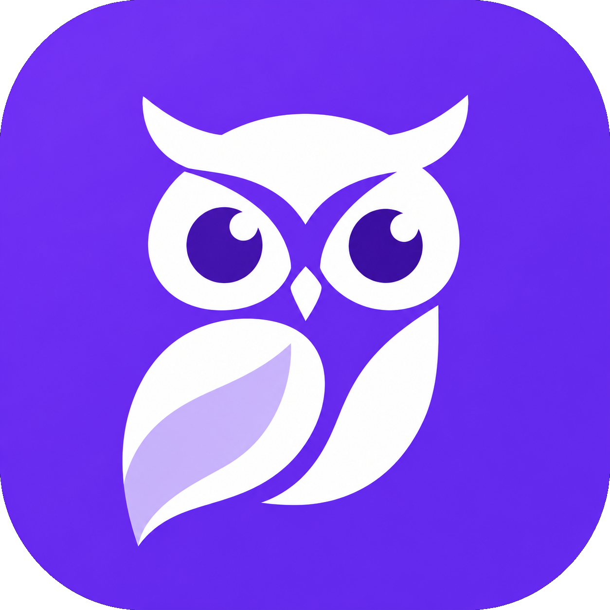

<p align="center">
  
</p>

<h1 align="center">Owl-L</h1>
<p align="center"><b>A free, offline, private translator for your desktop.</b></p>

Owl-L translates text and screen areas on your own computer. No account, no subscription, no tracking: your text and screenshots never leave your machine.

## Features

- Two-pane translation with automatic language detection
- **Documents**: translate Word, PowerPoint, Excel, text, Markdown and PDF files (a PDF becomes a Word document) on your computer, keeping the formatting
- **Word alternatives**: click a word of the translation to choose another one; the rest of the sentence follows
- **Glossary**: terms that must be translated your way, with CSV import and export
- Downloadable **language packs**: install only the languages you need
- **Ctrl+C+C** to translate selected text from any app (popup next to the pointer)
- **Area selection**: draw a box anywhere on screen and translate the text inside (images, videos, locked PDFs)
- Local history, tray icon, starts with your system (optional)
- Light and dark theme, UI in English and German

## Privacy and offline use

Once a language pack is installed, translation runs fully on your device.

- **No telemetry, no accounts, no analytics, no crash reports.** Owl-L never sends your text, screenshots, files or history anywhere.
- **What does leave your machine, and when:**
  - *Language pack downloads*: only when you install a pack, a plain download from [Hugging Face](https://huggingface.co/Second-Dawn-Lab/owll-language-packs) (checked against a checksum). Hugging Face sees the usual connection data (your IP address and the file you ask for).
  - *Update checks*: at most once a day at startup, and when you click "Check for updates", Owl-L downloads a small file (`latest.json`) from this repository's latest GitHub release. The new installer is downloaded only if you click "Update and restart". GitHub sees the usual connection data.
- Everything else (translation, text recognition, history, settings) stays on your computer. History can be turned off or cleared in the app.

## Download

Windows installer: **[Releases](https://github.com/Second-Dawn-Lab/owll/releases)** (the first release is coming soon).

### Windows may warn you

The installer is not code-signed yet, so Windows SmartScreen may show **"Windows protected your PC"** or "Unknown publisher" when you run it. This is expected for new, small apps. To continue, click **More info**, then **Run anyway**. You can compare the installer with the one on the Releases page, and the source code is in this repository. Code signing is planned (see [docs/releasing.md](docs/releasing.md)).

On first start Owl-L offers a short welcome where you choose your languages. The uninstaller keeps the downloaded language packs (other Second Dawn apps may use them) and asks whether to delete Owl-L's own settings and history.

## Screenshots

_Screenshots will be added here._

## Credits

Owl-L stands on the shoulders of **OPUS-MT (Helsinki-NLP)**, **CTranslate2**,and **Tauri** . Full model attributions are in the app's About screen. Owl-L is an independent project and is not affiliated with DeepL.

MIT licensed. See [LICENSE](LICENSE).

---

## For developers

### Status

| Works | Planned |
|---|---|
| Two-pane live translation with CTranslate2 (Opus-MT) | Drag-and-drop document translation |
| Language packs: download, cancel, resume, verify, remove, repair | Word alternatives |
| English as the hub; other pairs go through English | Optional LLM quality mode |
| Language detection among installed languages | Hosted language pack downloads |
| Ctrl+C+C popup, area selection with Windows OCR | |
| Local history, tray icon, settings, single instance | |

### Prerequisites

- Node.js 20+, [pnpm](https://pnpm.io), Rust (stable) and the [Tauri prerequisites](https://tauri.app/start/prerequisites/)
- **Windows:** the translation engine ([CTranslate2](https://github.com/OpenNMT/CTranslate2) with oneDNN) is compiled from source on the first build (about 13 minutes, a few GB of RAM). You need Visual Studio Build Tools (Desktop development with C++) and [CMake](https://cmake.org/download/) 3.18+ on your `PATH`. The static C runtime is set in [`.cargo/config.toml`](.cargo/config.toml).

### Get the code

Owl-L uses the shared code in [`dawn-core`](https://github.com/Second-Dawn-Lab/dawn-core), which must sit **next to** this folder:

```text
SecondDawn/
  dawn-core/
  owll/        <- this repo
```

```bash
git clone https://github.com/Second-Dawn-Lab/dawn-core
git clone https://github.com/Second-Dawn-Lab/owll
cd dawn-core && pnpm install      # the shared packages need their own dependencies
cd ../owll && pnpm install
```

Rust crates are path dependencies (`../dawn-core/crates/...`) and the TypeScript packages are `link:` dependencies (`../dawn-core/packages/...`), so edits in `dawn-core` show up here immediately, including hot reload in `tauri dev`.

### Run and build

```bash
pnpm tauri dev      # or run-owll.bat on Windows
pnpm build          # frontend only (the Tauri crate needs ./dist to exist)
pnpm tauri build    # installer
pnpm dev            # UI alone in a browser with a mock backend (src/ipc.mock.ts); add ?window=settings
```

The app starts with only English. Open **Language packs** (menu → Language packs) and download a language. Until the packs are hosted, build them locally: see `dawn-core/docs/models.md` and `dawn-core/tools/convert-models`.

### Checks and tests

```bash
pnpm lint
pnpm typecheck
cargo check --workspace
cargo test --workspace                                                      # unit tests
cargo test -p dawn-translate --test integration -- --ignored --nocapture    # needs converted de + ur models
```

### Updating dawn-core

CI and releases check out the `dawn-core` commit or tag named in [`dawn-core.ref`](dawn-core.ref), so builds are reproducible. To move to a newer `dawn-core`: test locally against it, then put its commit SHA or tag in `dawn-core.ref` and commit that together with any changes the new version needs. Never release with `main` in that file.

### Layout

```text
src/             React UI (talks to Rust only through src/ipc.ts)
src-tauri/src/   commands.rs (the API), settings.rs, history.rs, tray.rs, quick.rs, capture.rs, ocr.rs
docs/            CLONE_SPEC.md (behavioral spec), quick-access.md, ur-ja-models.md, releasing.md (releases, updater keys, signing)
assets/brand/    Owl-L app icon, Second Dawn logo and icon
dawn-core.ref    pinned dawn-core version for CI and releases
```

<p align="center">
  <br />
  <sub>by</sub><br />
  
</p>
